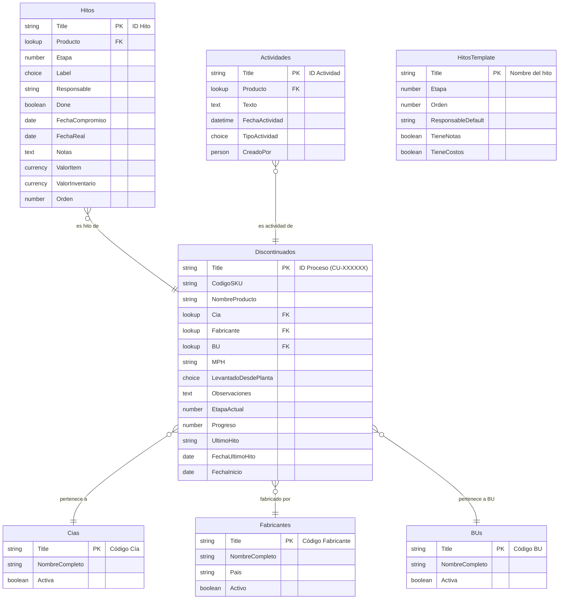

# Modelo de datos SharePoint Online

## Visión general

Se crean **7 listas** en un sitio SharePoint dedicado:
- **3 transaccionales**: Discontinuados, Hitos, Actividades
- **3 de catálogo**: Cias, Fabricantes, BUs
- **1 de configuración de proceso**: HitosTemplate

---

## Lista 1: Discontinuados (transaccional)

**Nombre display**: Discontinuados  
**Nombre interno**: Discontinuados  
**Propósito**: Registro maestro de cada SKU en proceso de discontinuación.  
**Volumen esperado**: ~500 ítems activos por ciclo; histórico acumulado ~5.000 en 10 años (requiere columnas indexadas).

| Nombre interno | Nombre visible | Tipo SharePoint | Obligatoria | Único | Valor por defecto | Opciones | Indexada | Origen |
|---|---|---|---|---|---|---|---|---|
| `Title` | ID Proceso | Línea de texto (1 línea) | Sí | Sí | — | — | **Sí** (clave) | `id` |
| `CodigoSKU` | Código SKU | Línea de texto | No | No | — | — | Sí (filtro frecuente) | `codigo` |
| `NombreProducto` | Descripción del producto | Línea de texto | Sí | No | — | — | No | `nombre` |
| `Cia` | Compañía | Búsqueda → lista Cias | Sí | No | — | — | **Sí** (filtro principal) | `paisCompania` |
| `Fabricante` | Fabricante / Planta | Búsqueda → lista Fabricantes | Sí | No | — | — | **Sí** (filtro planta) | `paisPlanta` |
| `BU` | Business Unit | Búsqueda → lista BUs | Sí | No | — | — | **Sí** (filtro BU) | `bu` |
| `MPH` | MPH | Línea de texto | No | No | — | — | No | `mph` |
| `LevantadoDesdePlanta` | ¿Levantado desde planta? | Elección | No | No | No especificado | Sí; No; No especificado | No | `levantadoSOPC` |
| `Observaciones` | Observaciones | Varias líneas de texto | No | No | — | — | No | `observaciones` |
| `EtapaActual` | Etapa actual | Número (entero) | Sí | No | 0 | — | **Sí** (filtro dashboard) | `etapaActual` |
| `EtapaLabel` | Etapa (texto) | Columna calculada | No | No | — | `=CHOOSE(EtapaActual+1,"Detección","Análisis","Confirmación")` | No | derivado |
| `Progreso` | Progreso (%) | Número | Sí | No | 0 | — | No | `progreso` |
| `UltimoHito` | Último hito completado | Línea de texto | No | No | Inicio proceso | — | No | `ultimoHito` |
| `FechaUltimoHito` | Fecha último hito | Fecha y hora (solo fecha) | No | No | Hoy | — | No | `fechaUltimoHito` |
| `FechaInicio` | Fecha de inicio | Fecha y hora (solo fecha) | Sí | No | Hoy | — | **Sí** (filtro cronológico) | `fechaInicio` |
| `CreadoPor` | Creado por | Persona | Automático | No | — | — | No | nuevo (auditoría) |
| `FechaCreacion` | Fecha de creación | Fecha y hora | Automático | No | — | — | No | nuevo |
| `ModificadoPor` | Modificado por | Automático (SP) | Automático | No | — | — | No | nuevo |
| `FechaModificacion` | Fecha de modificación | Automático (SP) | Automático | No | — | — | No | nuevo |

**Índices usados** (máx. 20): `Title`, `CodigoSKU`, `Cia`, `Fabricante`, `BU`, `EtapaActual`, `FechaInicio` = 7 índices.

**Validaciones de lista**:
- No aplica validación de lista compleja; las validaciones de campo se hacen por columna.

**Validaciones de columna** (fórmulas):
- `EtapaActual`: `=[EtapaActual]>=0 AND [EtapaActual]<=2`
- `Progreso`: `=[Progreso]>=0 AND [Progreso]<=100`

**Versiones**: habilitado (máx. 500 versiones principales). Sin aprobación.  
**Adjuntos**: deshabilitados (documentos van a biblioteca separada si se necesita).

---

## Lista 2: Hitos (transaccional)

**Nombre display**: Hitos  
**Nombre interno**: Hitos  
**Propósito**: Un ítem por hito por producto (16 hitos × ~500 productos = ~8.000 ítems activos).  
**Volumen**: ~8.000 activos; histórico ~80.000 — **por encima de 5.000, requiere todos los índices de filtro**.

| Nombre interno | Nombre visible | Tipo SharePoint | Obligatoria | Único | Valor por defecto | Opciones | Indexada | Origen |
|---|---|---|---|---|---|---|---|---|
| `Title` | ID Hito | Línea de texto | Sí | Sí | — | — | **Sí** | `id` |
| `Producto` | Producto | Búsqueda → Discontinuados (Title) | Sí | No | — | — | **Sí** (filtro principal) | lookup por `id` |
| `Etapa` | Etapa | Número | Sí | No | — | — | **Sí** | `etapa` |
| `Label` | Nombre del hito | Elección | Sí | No | — | 16 valores de `HITOS_TEMPLATE` | **Sí** (filtro frecuente) | `label` |
| `Responsable` | Área responsable | Línea de texto | No | No | — | — | No | `responsable` |
| `Done` | Completado | Sí/No | Sí | No | No | — | **Sí** (dashboard) | `done` |
| `FechaCompromiso` | Fecha compromiso | Fecha y hora | No | No | — | — | No | `fechaCompromiso` |
| `FechaReal` | Fecha real | Fecha y hora | No | No | — | — | No | `fechaReal` |
| `Notas` | Notas | Varias líneas de texto | No | No | — | — | No | `notas` |
| `OfreceUnidades` | Ofrece unidades | Línea de texto | No | No | — | — | No | `ofreceUnidades` |
| `ImpactoGranelLleva` | ¿Lleva granel? | Elección | No | No | — | Sí; No; N/A | No | `impactoGranelLleva` |
| `ImpactoGranelValor` | Valor impacto granel | Moneda | No | No | — | — | No | `impactoGranelValor` |
| `ResolucionFinal` | Resolución final | Varias líneas de texto | No | No | — | — | No | `resolucionFinal` |
| `ValorItem` | Costo unitario | Moneda | No | No | — | — | No | `valorItem` |
| `ValorInventario` | Valor de inventario | Moneda | No | No | — | — | No | `valorInventario` |
| `FechaUltimaOC` | Fecha última OC | Fecha y hora | No | No | — | — | No | `fecha` (en hito "Última OC") |
| `Orden` | Orden de visualización | Número | Sí | No | — | — | No | índice en `HITOS_TEMPLATE` |

**Índices**: `Producto`, `Etapa`, `Label`, `Done` = 4 índices. Total: 4 (bien dentro del límite de 20).

**Notas de diseño**:
- Los 16 hitos de cada producto se crean mediante un flujo Power Automate al crear el ítem padre en Discontinuados.
- El campo `Notas` (multiline) aplica solo a algunos hitos; se usa para todos (vacío en los que no aplica) para simplificar el esquema.
- Los campos `ValorItem`, `ValorInventario` solo se completan en hitos de costo.

**Relación**: Búsqueda a `Discontinuados.Title`. Comportamiento al eliminar producto: flujo Power Automate elimina los hitos relacionados antes de eliminar el producto (SharePoint no tiene cascade delete nativo en listas).

---

## Lista 3: Actividades (transaccional — log de auditoría)

**Nombre display**: Actividades  
**Nombre interno**: Actividades  
**Propósito**: Log append-only de comentarios y eventos de sistema por producto.  
**Volumen**: ~20 actividades × 500 productos = ~10.000 activos. Históricamente puede superar 5.000.

| Nombre interno | Nombre visible | Tipo SharePoint | Obligatoria | Indexada | Origen |
|---|---|---|---|---|---|
| `Title` | ID Actividad | Línea de texto | Sí | Sí | `id` |
| `Producto` | Producto | Búsqueda → Discontinuados | Sí | **Sí** | lookup por producto |
| `Texto` | Texto | Varias líneas de texto | Sí | No | `text` |
| `FechaActividad` | Fecha y hora | Fecha y hora | Sí | **Sí** | `time` (parseado) |
| `TipoActividad` | Tipo | Elección | Sí | No | nuevo; valores: Comentario; Avance de etapa; Sistema; Hito completado |
| `CreadoPor` | Creado por | Persona (auto) | Auto | No | nuevo |

**Nivel de permiso**: lista con permiso personalizado "Solo agregar" (sin editar ni eliminar ítems propios). Ver Fase 4.

**Índices**: `Producto`, `FechaActividad` = 2 índices.

---

## Lista 4: Cias (catálogo)

**Nombre display**: Compañías  
**Nombre interno**: Cias  
**Propósito**: Catálogo de compañías Megalabs. Fuente: `src/data/db.js:3-7` (13 valores).

| Nombre interno | Nombre visible | Tipo | Obligatoria |
|---|---|---|---|
| `Title` | Código Cía | Línea de texto | Sí |
| `NombreCompleto` | Nombre completo | Línea de texto | No |
| `Activa` | Activa | Sí/No | Sí |

**Acceso**: lectura para todos los grupos; escritura solo Admin.

---

## Lista 5: Fabricantes (catálogo)

**Nombre display**: Fabricantes  
**Nombre interno**: Fabricantes  
**Propósito**: Catálogo de plantas fabricantes. Fuente: `src/data/db.js:9-15` (31 valores).

| Nombre interno | Nombre visible | Tipo | Obligatoria |
|---|---|---|---|
| `Title` | Código Fabricante | Línea de texto | Sí |
| `NombreCompleto` | Nombre completo | Línea de texto | No |
| `Pais` | País | Línea de texto | No |
| `Activo` | Activo | Sí/No | Sí |

---

## Lista 6: BUs (catálogo)

**Nombre display**: Unidades de Negocio  
**Nombre interno**: BUs  
**Propósito**: Catálogo de Business Units. Fuente: `src/data/db.js:17` (5 valores: Primary, Consumer, Divise, Hi-Tech, Nutraceutical).

| Nombre interno | Nombre visible | Tipo | Obligatoria |
|---|---|---|---|
| `Title` | Código BU | Línea de texto | Sí |
| `NombreCompleto` | Nombre completo | Línea de texto | No |
| `Activa` | Activa | Sí/No | Sí |

---

## Lista 7: HitosTemplate (configuración de proceso)

**Nombre display**: Plantilla de Hitos  
**Nombre interno**: HitosTemplate  
**Propósito**: Define los 16 hitos estándar del proceso. Usada por el flujo de Power Automate al crear productos. Fuente: `src/data/db.js:20-40`.

| Nombre interno | Nombre visible | Tipo | Obligatoria |
|---|---|---|---|
| `Title` | Nombre del hito | Línea de texto | Sí |
| `Etapa` | Etapa | Número (0/1/2) | Sí |
| `Orden` | Orden | Número | Sí |
| `ResponsableDefault` | Responsable por defecto | Línea de texto | No |
| `TieneNotas` | Tiene campo Notas | Sí/No | No |
| `TieneCostos` | Tiene campos de costo | Sí/No | No |
| `TieneImpactoGranel` | Tiene campos granel | Sí/No | No |
| `TieneFechaOC` | Tiene fecha de OC | Sí/No | No |

**Acceso**: lectura para todos; escritura solo Admin (catálogo de proceso).

---

## Diagrama de relaciones

