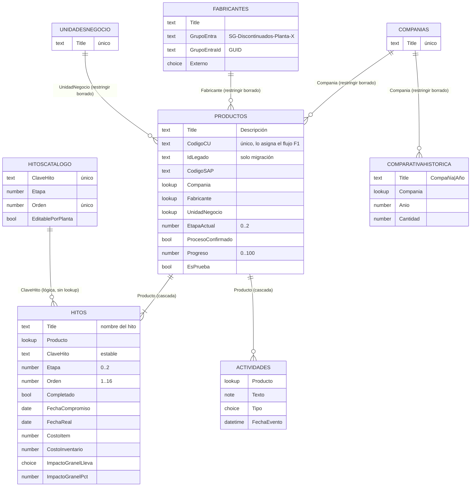

# 03 — Modelo de datos en SharePoint Online (Fase 3)

> Fuente única legible por máquina: [`sharepoint-schema.json`](./sharepoint-schema.json). Las tablas de columnas de este
> documento están generadas desde ese archivo; si hay diferencias, manda el JSON.
> Las columnas de seguridad por fila y los flujos que las mantienen se explican en [04-seguridad.md](./04-seguridad.md) y
> [05-logica-e-integraciones.md](./05-logica-e-integraciones.md).

## 1. Resumen

El modelo actual es **un único documento JSON** (`/discontinuados` → `products[]`, con hitos y actividades anidados),
reescrito completo en cada cambio (`src/context/AppContext.jsx:35-42`). En SharePoint se separa en **8 listas**:

| Lista | Tipo | Qué reemplaza | Filas hoy (tras migrar) | Riesgo frente al umbral de 5.000 |
|---|---|---|---:|---|
| `Productos` | Transaccional | `products[]` | 224 | Bajo (≈ 2.000 a 4 años) |
| `Hitos` | Transaccional | `products[].hitos[]` | 3.584 | **Alto**: supera 5.000 desde ~313 productos. Todas las consultas filtran por columna indexada |
| `Actividades` | Transaccional | `products[].actividades[]` | 8 | Medio (1.500–5.000 por ciclo) |
| `ComparativaHistorica` | Parametría editable | `localStorage` `mgl_comparativa_hist` | 0 | Nulo |
| `Companias` | Catálogo | `CIAS` (`src/data/db.js:3-7`) | 13 | Nulo |
| `Fabricantes` | Catálogo | `FABRICANTES` (`src/data/db.js:9-15`) | 31 | Nulo |
| `UnidadesNegocio` | Catálogo | `BUS` (`src/data/db.js:17`) | 5 | Nulo |
| `HitosCatalogo` | Catálogo | `HITOS_TEMPLATE`, `RESPONSABLES_DEFAULT`, `HITOS_CON_EXTRAS` (`src/data/db.js:20-73`) | 16 | Nulo |

**Quedan fuera** (decisión del dueño de negocio): el sub-módulo `plant-reports` (backlog) y el mapeo de `Responsable` a
usuarios de Entra ID (backlog). **No se crea lista de usuarios**: la lista `mgl_users` de `localStorage`
(`src/data/users.js:1-19`) la reemplaza la pertenencia a grupos de Entra ID.

## 2. Diagrama entidad-relación

## 3. Convenciones

- **Nombres internos** en CamelCase ASCII, sin espacios ni tildes (`UnidadNegocio`, no `Unidad de negocio`), para evitar
  codificaciones `_x0020_`. Los nombres visibles sí llevan tildes.
- **`Title`** se reutiliza como campo principal de cada lista (en `Productos` es la *Descripción*; en `Actividades` es
  opcional y se oculta del formulario).
- **Relaciones** con columnas de búsqueda (*lookup*) a catálogos. SharePoint exige que la columna esté **indexada** para
  aplicar "Restringir eliminación" o "Eliminar en cascada"; todas las del modelo lo están.
- **Moneda no definida**: el código muestra los montos como número con formato `es-AR` y sin símbolo
  (`src/pages/DashboardView.jsx:17-19`). Se guardan como `Number` con 2 decimales; ⚠️ SUPUESTO: la moneda es una sola para
  todo el proceso. Ver pregunta abierta en el README.
- **Booleanos** del código (`done`, `'si'/'no'`) pasan a `Sí/No` o a `Choice` con texto legible.

## 4. Listas

### 4.1 `Productos`

**Propósito.** Un ítem por SKU en proceso de discontinuación. Reemplaza products[] del nodo Firebase /discontinuados. Guarda también los agregados (etapa, progreso, último hito) que mantiene el flujo F2, para que ningún rol necesite leer todos los hitos para mostrar el tablero.

| Nombre interno | Visible | Tipo | Oblig. | Único | Default | Indexada | Origen en el modelo actual |
|---|---|---|:-:|:-:|---|:-:|---|
| `Title` | Descripción | Texto (255) | Sí |  | — |  | nombre (NuevoProducto.jsx:60) |
| `CodigoCU` | Código CU | Texto (20) |  | Sí | — | Sí | id (db.js:162; NuevoProducto.jsx:58) — Lo asigna el flujo F1: CU- + (100000 + ID). No lo escribe el usuario. |
| `IdLegado` | ID legado Firebase | Texto (20) |  |  | — | Sí | id (db.js:162) — Solo migración. Sirve para re-ejecutar la carga sin duplicar. |
| `CodigoSAP` | Código SAP | Texto (50) |  |  | — |  | codigo (NuevoProducto.jsx:59) |
| `Compania` | Compañía | Búsqueda → Companias (restringir) | Sí |  | — | Sí | paisCompania (db.js:3-7) |
| `Fabricante` | Fabricante | Búsqueda → Fabricantes (restringir) | Sí |  | — | Sí | paisPlanta (db.js:9-15) |
| `UnidadNegocio` | BU | Búsqueda → UnidadesNegocio (restringir) | Sí |  | — | Sí | bu (db.js:17) |
| `Mph` | MPH | Texto (100) |  |  | — |  | mph (NuevoProducto.jsx:64) |
| `Observaciones` | Observaciones | Texto multilínea (plano) |  |  | — |  | observaciones (NuevoProducto.jsx:65) |
| `LevantadoPorPlanta` | ¿Se levantó desde la planta? | Opción: Sí / No |  |  | — |  | levantadoSOPC (NuevoProducto.jsx:66,150) — En el código es 'si'/'no'/vacío. |
| `EtapaActual` | Etapa actual | Número [0–2], 0 dec. | Sí |  | `0` | Sí | etapaActual (AppContext.jsx:83) — 0=Detección, 1=Análisis, 2=Confirmación (igual que el código). |
| `EtapaNombre` | Etapa | Calculada (texto): `=CHOOSE([EtapaActual]+1,"Detección","Análisis","Confirmación")` |  |  | — |  | etapas[].nombre (db.js:1) |
| `ProcesoConfirmado` | Proceso confirmado | Sí/No |  |  | No | Sí | etapas[2].estado='completado' (AppContext.jsx:107-127) — Sí cuando todos los hitos de la etapa 2 están completados. |
| `Progreso` | Progreso (%) | Número [0–100], 0 dec. |  |  | `0` |  | progreso (AppContext.jsx:79-80) — Lo recalcula el flujo F2. |
| `UltimoHito` | Último hito | Texto (255) |  |  | `Inicio proceso` |  | ultimoHito (AppContext.jsx:81) |
| `FechaUltimoHito` | Fecha último hito | Fecha |  |  | — |  | fechaUltimoHito (NuevoProducto.jsx:70) |
| `FechaInicio` | Fecha de inicio | Fecha | Sí |  | `=[today]` |  | fechaInicio (NuevoProducto.jsx:71) |
| `EsPrueba` | Es dato de prueba | Sí/No |  |  | No | Sí | regex /^CU-000\d{3}$/ (AppContext.jsx:211) — Reemplaza el regex de borrado masivo. Los 224 del seed se migran en Sí. |
| `PermisosAplicados` | Permisos de planta aplicados | Sí/No |  |  | No | Sí | (nuevo, técnico) — Solo lo escriben los flujos F1/F3/F4. Permite a F4 encontrar productos sin permisos asignados. |
| `FabricantePermisoId` | Fabricante con permiso vigente | Número, 0 dec. |  |  | — |  | (nuevo, técnico) — Solo flujos. Id del ítem de Fabricantes cuyo grupo tiene hoy permiso; F3 lo compara para detectar un cambio de fabricante. |
| `EtapaValidada` | Etapa validada | Número [0–2], 0 dec. |  |  | `0` |  | (nuevo, técnico) — Solo flujos. Última etapa aceptada; F3 la compara con EtapaActual para revertir saltos inválidos. |

**Relaciones.** `Compania`, `Fabricante` y `UnidadNegocio` son búsquedas **obligatorias** con *Restringir eliminación*: no se
puede borrar un fabricante que tenga productos.

**Columnas que el frontend actual guarda y que ya no se persisten** (se derivan):
- `etapas[]` (`NuevoProducto.jsx:72-76`): `etapas[i].estado` es `completado` si `i < EtapaActual`, `en_progreso` si
  `i = EtapaActual`, `pendiente` si `i > EtapaActual`; la etapa 3 pasa a `completado` cuando `ProcesoConfirmado = Sí`
  (`AppContext.jsx:107-127`). El nombre de la etapa sale de `EtapaNombre` (calculada).
- `actividades[]` → lista `Actividades`; `hitos[]` → lista `Hitos`.

**Validaciones.**
- Lista: `=OR(ISBLANK([FechaUltimoHito]),[FechaUltimoHito]>=[FechaInicio])` — *"La fecha del último hito no puede ser anterior
  a la fecha de inicio."*
- Columna (nativas): `EtapaActual` 0–2 y `Progreso` 0–100.
- `Compania`, `Fabricante`, `UnidadNegocio` y `Title` obligatorios (mismas reglas que `validate()` en
  `NuevoProducto.jsx:35-42`).
- Unicidad de `CodigoCU` por índice único.

**Columnas técnicas** (`PermisosAplicados`, `FabricantePermisoId`, `EtapaValidada`): las escriben solo los flujos; el frontend
no debe mostrarlas ni editarlas. Sirven para que F3/F4 detecten cambios y reparen (ver 04-seguridad.md §3).

**Columnas calculadas.** `EtapaNombre` = `=CHOOSE([EtapaActual]+1,"Detección","Análisis","Confirmación")`.

**Auditoría.** `Creado/Modificado` y `Creado por/Modificado por` son automáticos. Versionado **activado, 50 versiones**
(no hay requisito GxP/Part 11: respuesta del dueño de negocio). No se agregan columnas de aprobación: **no existe un
aprobador de etapa** (el avance lo hacen los propios usuarios con permiso de edición; ver 02-roles-y-permisos.md).

**Configuración.** Sin adjuntos, sin aprobación de contenido, sin carpetas. **Volumen**: 224 filas hoy; proyección: ≤ 500 activos por ciclo; ~2.000 acumulados a 4 años. Riesgo frente al umbral de 5.000: Bajo

### 4.2 `Hitos`

**Propósito.** 16 ítems por producto, creados por el flujo F1 a partir de HitosCatalogo. Reemplaza products[].hitos[]. Los campos extra (costos, granel, OC, notas) viven en el hito que corresponde, igual que hoy.

| Nombre interno | Visible | Tipo | Oblig. | Único | Default | Indexada | Origen en el modelo actual |
|---|---|---|:-:|:-:|---|:-:|---|
| `Title` | Hito | Texto (255) | Sí |  | — |  | label (db.js:20-40) |
| `Producto` | Producto | Búsqueda → Productos (cascada) | Sí |  | — | Sí | products[].hitos[] (anidado) |
| `ClaveHito` | Clave de hito | Texto (50) | Sí |  | — | Sí | (nuevo) clave estable; el código identifica hitos por label (db.js:113) |
| `Etapa` | Etapa | Número [0–2], 0 dec. | Sí |  | — | Sí | etapa (db.js:22) |
| `Orden` | Orden | Número [1–16], 0 dec. | Sí |  | — |  | índice en HITOS_TEMPLATE (db.js:20) |
| `Responsable` | Responsable | Texto (255) |  |  | — |  | responsable (db.js:56-73) — Texto libre, igual que hoy (mapeo a usuario Entra ID: backlog por decisión del dueño). |
| `Completado` | Completado | Sí/No |  |  | No | Sí | done (AppContext.jsx:77) |
| `FechaCompromiso` | Fecha compromiso | Fecha |  |  | — |  | fechaCompromiso (db.js:88) — '-' en el código = vacío. |
| `FechaReal` | Fecha real | Fecha |  |  | — |  | fechaReal (AppContext.jsx:77) — La completa el flujo F2 al marcar Completado. |
| `Notas` | Notas | Texto multilínea (plano) |  |  | — |  | notas (db.js:44,49) — Solo Inventario PT y Productos en cola. |
| `OfreceUnidades` | ¿Ofrece unidades a otra compañía? | Opción: Sí / No |  |  | — |  | ofreceUnidades (db.js:44; ProductDetail.jsx:258-270) — Solo Inventario PT. |
| `ImpactoGranelLleva` | Impacto sobre granel | Opción: Lleva / No lleva |  |  | — |  | impactoGranelLleva (db.js:45; ProductDetail.jsx:300-318) — Solo Análisis de impacto planta. |
| `ImpactoGranelPct` | % impacto granel | Número [0–100], 2 dec. |  |  | — |  | impactoGranelValor (ProductDetail.jsx:321-326) — Texto con coma en el código (ej. '0,0'). |
| `ResolucionFinal` | Resolución final de ítems / inventarios | Texto multilínea (plano) |  |  | — |  | resolucionFinal (ProductDetail.jsx:288-292) — Solo Análisis de impacto planta. |
| `CostoItem` | Costo ítem | Número [0–], 2 dec. |  |  | — |  | valorItem (ProductDetail.jsx:196-206) — Moneda no definida en el código: ⚠️ SUPUESTO sin símbolo (DashboardView.jsx:17-19). |
| `CostoInventario` | Costo inventario | Número [0–], 2 dec. |  |  | — |  | valorInventario (ProductDetail.jsx:210-218; DashboardView.jsx:26) |
| `FechaUltimaOC` | Fecha última OC (mes) | Fecha |  |  | — |  | fecha (db.js:50; ProductDetail.jsx:224-230) — El código usa <input type=month> ('AAAA-MM'); se guarda el día 1. |

**Relaciones.** `Producto` → `Productos` con **eliminación en cascada**: al borrar un producto de prueba se borran sus 16
hitos (hoy lo hace `removeBulkProducts`, `AppContext.jsx:208-213`, filtrando el arreglo).

**Qué campo extra vive en qué hito** (idéntico a `HITOS_CON_EXTRAS`, `src/data/db.js:43-51`):

| `ClaveHito` | Columnas extra usadas |
|---|---|
| `INVENTARIO_PT` | `Notas`, `OfreceUnidades` |
| `IMPACTO_PLANTA` | `ImpactoGranelLleva`, `ImpactoGranelPct`, `ResolucionFinal` |
| `COSTO_DEST_PT`, `COSTO_DEST_MAT`, `COSTO_INV_API` | `CostoItem`, `CostoInventario` |
| `COLA_PRODUCCION` | `Notas` |
| `ULTIMA_OC` | `FechaUltimaOC` |
| (los 9 restantes) | ninguna |

Se eligió **dejar las columnas extra en `Hitos`** (dispersas) y no moverlas a una lista 1:1 por tres razones: respeta el
modelo y la pantalla actuales (`ProductDetail.jsx:187-330`), permite que cada hito tenga su propio permiso de edición
(la planta edita sus 5 hitos y nada más) y evita una segunda lista con permisos únicos.

**Validaciones.** Nativas: `ImpactoGranelPct` 0–100, `CostoItem`/`CostoInventario` ≥ 0, `Etapa` 0–2, `Orden` 1–16.
**Límite de SharePoint**: no puede validarse "solo se completa `FechaReal` si `Completado`" porque la validación no ve el
valor anterior; lo resuelve el flujo F2.

**Configuración.** Versionado activado (50). **Volumen**: 3584 filas hoy; proyección: 16 × productos: 8.000 a 500 productos; 32.000 a 2.000 acumulados. Riesgo frente al umbral de 5.000: ALTO: supera 5.000 desde ~313 productos. Toda consulta debe filtrar por una columna indexada (Producto, ClaveHito, Etapa) o paginar por ID.

### 4.3 `Actividades`

**Propósito.** Bitácora y comentarios por producto. Reemplaza products[].actividades[]. El autor es 'Creado por' (hoy el nombre está escrito a mano en el texto: AppContext.jsx:60).

| Nombre interno | Visible | Tipo | Oblig. | Único | Default | Indexada | Origen en el modelo actual |
|---|---|---|:-:|:-:|---|:-:|---|
| `Title` | Resumen | Texto (255) |  |  | — |  | (nuevo) primeros 100 caracteres de Texto; lo completa el flujo |
| `Producto` | Producto | Búsqueda → Productos (cascada) | Sí |  | — | Sí | products[].actividades[] |
| `Texto` | Texto | Texto multilínea (plano) | Sí |  | — |  | text (AppContext.jsx:60) |
| `Tipo` | Tipo | Opción: Comentario / Observación / Avance de etapa / Sistema |  |  | `Comentario` |  | (nuevo) se deduce del texto |
| `FechaEvento` | Fecha del evento | Fecha y hora |  |  | `=[today]` |  | time 'DD/MM HH:MM' (AppContext.jsx:47-54) — Para ítems migrados conserva la fecha original (el código no guarda el año). |

**Relaciones.** `Producto` → `Productos` en cascada.

**Auditoría.** El autor es `Creado por`; **corrige el hallazgo S5** (nombre fijo "Ariana S. (S&OP Global)" en
`AppContext.jsx:60`). Configuración avanzada de la lista: *crear y editar solo ítems propios* (`WriteSecurity = Own`).
**Volumen**: 8 filas hoy; proyección: ≈ 3 a 10 por producto y año: 1.500 a 5.000 por ciclo. Riesgo frente al umbral de 5.000: MEDIO: indexada por Producto; consultar siempre filtrando por producto.

### 4.4 `ComparativaHistorica`

**Propósito.** Cantidad de discontinuados de años anteriores por compañía, que hoy se tipea a mano y vive en el localStorage de cada navegador (Comparativa.jsx:12,23-31,118).

| Nombre interno | Visible | Tipo | Oblig. | Único | Default | Indexada | Origen en el modelo actual |
|---|---|---|:-:|:-:|---|:-:|---|
| `Title` | Clave | Texto (50) | Sí | Sí | — | Sí | (nuevo) '<Compañía>\|<Año>', evita duplicados |
| `Compania` | Compañía | Búsqueda → Companias (restringir) | Sí |  | — | Sí | hist[cia] (Comparativa.jsx:28) |
| `Anio` | Año | Número [2000–2100], 0 dec. | Sí |  | — | Sí | y2024 / y2025 (Comparativa.jsx:28) |
| `Cantidad` | Cantidad | Número [0–], 0 dec. | Sí |  | — |  | valor tipeado (Comparativa.jsx:73-98) |

La clave `Title` = `<Compañía>|<Año>` (ej. `Bol-Mlb|2025`) impide duplicados porque SharePoint no tiene índice único
compuesto. Hoy la pantalla ofrece dos columnas fijas (2024 y 2025); en la lista se agregan filas por año sin tocar el
modelo.

### 4.5 Catálogos

**`Companias`** — Catálogo CIAS (13 valores).

| Nombre interno | Visible | Tipo | Oblig. | Único | Default | Indexada | Origen en el modelo actual |
|---|---|---|:-:|:-:|---|:-:|---|
| `Title` | Código | Texto (50) | Sí | Sí | — | Sí | CIAS (db.js:3-7) |
| `NombreCompleto` | Nombre completo | Texto (255) |  |  | — |  | (no existe en el código) — Opcional: ⚠️ el dueño de negocio debe completarlo si lo necesita. |
| `Activa` | Activa | Sí/No |  |  | Sí |  | (nuevo) |

**`Fabricantes`** — Catálogo FABRICANTES (31 valores). Cada fila apunta al grupo de Entra ID que representa a esa planta; de ahí sale quién ve los productos (ver 04-seguridad.md).

| Nombre interno | Visible | Tipo | Oblig. | Único | Default | Indexada | Origen en el modelo actual |
|---|---|---|:-:|:-:|---|:-:|---|
| `Title` | Fabricante | Texto (100) | Sí | Sí | — | Sí | FABRICANTES (db.js:9-15) |
| `Externo` | Es tercero (usuarios invitados) | Opción: Sí / No / Desconocido |  |  | `Desconocido` |  | (nuevo) — ⚠️ El código no distingue plantas propias de terceras. |
| `GrupoEntra` | Grupo Entra ID | Texto (120) |  |  | — |  | (nuevo) — SG-Discontinuados-Planta-<Fabricante> |
| `GrupoEntraId` | Id de objeto del grupo | Texto (40) |  |  | — |  | (nuevo) — GUID. Lo completa el script de aprovisionamiento; lo usa el flujo F1. |
| `Activa` | Activa | Sí/No |  |  | Sí |  | (nuevo) |

**`UnidadesNegocio`** — Catálogo BUS (5 valores).

| Nombre interno | Visible | Tipo | Oblig. | Único | Default | Indexada | Origen en el modelo actual |
|---|---|---|:-:|:-:|---|:-:|---|
| `Title` | BU | Texto (50) | Sí | Sí | — | Sí | BUS (db.js:17) |
| `Activa` | Activa | Sí/No |  |  | Sí |  | (nuevo) |

**`HitosCatalogo`** — Los 16 hitos estándar. Reemplaza HITOS_TEMPLATE, RESPONSABLES_DEFAULT y HITOS_CON_EXTRAS (db.js:20-73). El flujo F1 lo lee para crear los hitos; cambiar el proceso no requiere redeploy.

| Nombre interno | Visible | Tipo | Oblig. | Único | Default | Indexada | Origen en el modelo actual |
|---|---|---|:-:|:-:|---|:-:|---|
| `Title` | Hito | Texto (255) | Sí | Sí | — | Sí | label (db.js:20-40) |
| `ClaveHito` | Clave de hito | Texto (50) | Sí | Sí | — | Sí | (nuevo) |
| `Etapa` | Etapa | Número [0–2], 0 dec. | Sí |  | — |  | etapa (db.js:22) |
| `Orden` | Orden | Número [1–99], 0 dec. | Sí | Sí | — | Sí | índice (db.js:20) |
| `ResponsableDefault` | Responsable por defecto | Texto (255) |  |  | — |  | RESPONSABLES_DEFAULT (db.js:56-73) |
| `EditablePorPlanta` | Editable por la planta | Sí/No |  |  | No |  | responsable == 'Planta' (db.js:63-67) — Define a qué hitos recibe permiso de edición el grupo de la planta. |
| `Activa` | Activa | Sí/No |  |  | Sí |  | (nuevo) |

Contenido inicial del catálogo de hitos (`seed.HitosCatalogo` del JSON):

| Orden | `ClaveHito` | Hito | Etapa | Responsable por defecto | ¿Editable por la planta? |
|--:|---|---|:-:|---|:-:|
| 1 | `DETECCION_SKU` | Detección del SKU a discontinuar | 1 | Cualquier área | No |
| 2 | `PRESUPUESTO_ANUAL` | Presentación de Presupuesto Anual | 1 | Mkt Corp | No |
| 3 | `TEMPLATE_DISCONTINUACION` | Análisis de Template de Discontinuación | 1 | Mkt Corp | No |
| 4 | `AVISO_SUPPLY_SOP` | Aviso a Supply Corp y S&OP Global | 1 | Área detectante | No |
| 5 | `INVENTARIO_PT` | Inventario PT | 2 | Supply Chain Corp | No |
| 6 | `NOTIF_MKT_PLANTA` | Notificación a Mkt Corp y Aviso a Planta | 2 | Supply Chain Corp | No |
| 7 | `IMPACTO_PLANTA` | Análisis de impacto planta | 2 | Planta | **Sí** |
| 8 | `COSTO_DEST_PT` | Costo destrucción PT | 2 | Planta | **Sí** |
| 9 | `COSTO_DEST_MAT` | Costo destrucción materiales | 2 | Planta | **Sí** |
| 10 | `COSTO_INV_API` | Costo inventario API | 2 | Planta | **Sí** |
| 11 | `COLA_PRODUCCION` | Productos en cola de producción | 2 | Planta | **Sí** |
| 12 | `ULTIMA_OC` | Última OC | 2 | Supply Corp | No |
| 13 | `CONFIRMACION_MKT` | Confirmación con Mkt Corp | 3 | Supply Corp + S&OP Global | No |
| 14 | `NOTIF_DEPARTAMENTOS` | Notificación a todos los departamentos | 3 | S&OP Global | No |
| 15 | `INACTIVACION_CODIGO` | Inactivación del código en sistema | 3 | Supply Chain Corp | No |
| 16 | `PLAN_DESAGOTE` | Plan de desagote de inventario | 3 | Mkt Local & Cía | No |

Las filas de `Companias` (13), `Fabricantes` (31) y `UnidadesNegocio` (5) salen de `src/data/db.js:3-17`. Los catálogos
son de **solo lectura para todos salvo Admin** (ver 04-seguridad.md).

## 5. Decisiones de modelado

| Decisión | Alternativa descartada | Motivo |
|---|---|---|
| Hitos en lista aparte (16 por producto) | 64+ columnas en `Productos` (4 por hito) | Permite permisos distintos por hito, consultas por hito y auditoría individual. Costo: volumen 16×. |
| Catálogos como listas con lookup | Columnas de opción (`Choice`) | El código ya los maneja como catálogos editables (`Configuracion`); `Fabricantes` además guarda el grupo de Entra de cada planta. |
| `CodigoCU` generado por flujo | `CU-` + timestamp en el cliente (`NuevoProducto.jsx:58`) | El timestamp de 6 dígitos puede colisionar y hasta coincidir con el patrón de borrado de prueba (`AppContext.jsx:211`). Los ítems nuevos reciben `CU-` + (100000 + ID de SharePoint); los migrados conservan su id en `IdLegado`. |
| `EsPrueba` (booleano) | Regex `^CU-000\d{3}$` | Hace explícito qué se puede borrar en masa y no depende de un formato de id. |
| `EtapaActual` numérica 0–2 | Choice de texto | Mantiene el contrato del código (`etapaActual`), se ordena y se indexa. |
| `CostoItem`/`CostoInventario` como `Number` | Texto `"1.234,56"` (`ProductDetail.jsx:196-218`) | Permite sumar (`DashboardView.jsx:26-30`) sin parsear. La migración convierte el texto (ver 06). |
| `FechaUltimaOC` como fecha (día 1) | Texto `AAAA-MM` | Se puede filtrar y ordenar; el frontend muestra solo mes/año. |
| `Progreso`, `UltimoHito`, `EtapaActual` guardados en `Productos` | Calcular en el cliente desde los hitos | Los usuarios de planta **no pueden leer todos los hitos** de su producto (04-seguridad.md), y el tablero no debe cargar 16 × N ítems. |

## 6. Lo que SharePoint **no** garantiza (y quién lo cubre)

| Regla | ¿La garantiza SharePoint? | Cobertura |
|---|---|---|
| Un hito no se crea ni se borra a mano | Parcial (los niveles de permiso quitan *Agregar/Eliminar* a Editor y Planta) | Flujo F2 restituye columnas estructurales |
| La etapa solo avanza si se cumplió la regla (`ProductDetail.jsx:89-99`) | **No** (no compara valor anterior) | Flujo F3 revierte transiciones inválidas y deja una actividad |
| Integridad referencial entre listas | Sí, solo con lookup indexado (restringir/cascada) | Configurado en el modelo |
| Transacciones entre varias listas | **No** | Flujos con reintentos y reconciliación nocturna (F4) |
| Consistencia de permisos por ítem | **No** (los asigna un flujo, no es atómico) | Falla cerrada (sin permiso = sin acceso) + F4 |

## 7. Presupuesto de límites de SharePoint

| Límite | Uso del modelo |
|---|---|
| Umbral de vista 5.000 | Solo `Hitos` (y a futuro `Actividades`) lo superan. Consultas permitidas: por `Producto` (16 filas), por `ClaveHito` (≤ N), por `Etapa` (≤ 8 × N, válido hasta ~625 productos) o paginando por `ID`. **Prohibido** pedir "todos los hitos" sin filtro. |
| 20 índices por lista | Máximo 9 (`Productos`). |
| 12 columnas de búsqueda por consulta | Máximo 5 contando `Creado por`/`Modificado por` (`Productos`). |
| Permisos únicos por ítem (recomendado ≤ 5.000) | 6 por producto activo: 1 en `Productos` + 5 en `Hitos`. A 224 productos = 1.344; a 500 = 3.000; el techo se alcanza en ~833 activos. F3 retira los 5 de `Hitos` al confirmar el producto. |
| Throttling ~600 solicitudes/min por usuario | La importación masiva debe ir en lotes y con espera; ver 06. |

## 8. Alternativa: Dataverse (mapeo)

Si IT habilita Dataverse, el mismo modelo se traduce así (ver criterios de decisión en el README):

| SharePoint | Dataverse |
|---|---|
| `Productos` | Tabla `Producto`, propiedad = equipo de la planta |
| `Hitos`, `Actividades` | Tablas hijas con relación **Parental** (el permiso se hereda del producto) |
| Catálogos | Tablas de referencia (o conjuntos de opciones globales) |
| Permisos únicos por flujo | Seguridad por fila nativa (unidad de negocio / equipo de acceso) |
| Costos visibles a todos | Seguridad por columna (perfil de campo) si se necesita restringir |
